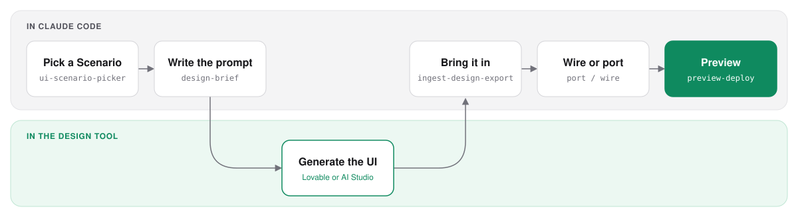

<div align="center">


# UI Workflow Skills

**Redesign any project's UI by talking to Claude. No code needed.**

A Claude Code plugin that walks a non-technical Stakeholder from "this UI looks dated" to a new UI live on a Preview link, using Lovable or Google AI Studio as the design tool.

[](CHANGELOG.md)
[](https://github.com/qsang793/ui-workflow-skills/actions/workflows/validate.yml)
[](docs/status.md)
[](LICENSE)

[Stakeholder guide](docs/stakeholder-guide.md) · [Hướng dẫn tiếng Việt](docs/stakeholder-guide.vi.md) · [Install](docs/install.md) · [Status](docs/status.md)


<sub>Illustrative, with a synthetic bakery, not a recorded run. [Full 49 s walkthrough (MP4)](docs/demo/film/film.mp4) · [Source](docs/demo/film/)</sub>

</div>

## Why

- **The Stakeholder drives.** Claude asks plain questions, writes the design prompt and brings the generated UI into the project.
- **The Developer only unblocks.** A skill stops on a Blocker and names it; the Developer pushes, merges and releases at the end.
- **Nothing reaches production.** Skills commit only to a `ui-workflow/<date>` Work branch and stop at an approved Preview.

## How it works

<picture>
  <source media="(prefers-color-scheme: dark)" srcset="docs/assets/how-it-works-dark.svg">
  
</picture>

| Scenario | When |
|---|---|
| **A. Greenfield** | No frontend yet |
| **B. Stack migration** | Rewrite the frontend in a new stack |
| **C. Keep stack** | Restyle the frontend in its current stack |

Every step is one command, and `.ui-workflow/state.md` remembers where you are. The full step-by-step walkthrough is in the [Stakeholder guide](docs/stakeholder-guide.md).

## Install

```bash
claude plugin marketplace add qsang793/ui-workflow-skills
```

```bash
claude plugin install ui-workflow-skills@ui-workflow-skills
```

Updating, a symlink install with short command names, and the Vercel or cloudflared setup for the Preview step: [docs/install.md](docs/install.md).

## Quick start

Open the project in Claude Code (it must be a git repository) and run:

```
/ui-workflow-skills:ui-scenario-picker
```

It reads the project, asks a few questions and picks the Scenario. After each step, the skill tells you the next command to run.

## Status

**Beta.** The skills pass behavioural evals, but no Scenario has finished a real end-to-end pilot yet. Details: [docs/status.md](docs/status.md).

## Contributing

Checks, release steps and the repository layout: [CONTRIBUTING.md](CONTRIBUTING.md). Vocabulary: [GLOSSARY.md](GLOSSARY.md). Decisions: [docs/adr/](docs/adr/).

## License

MIT. See [LICENSE](LICENSE).
